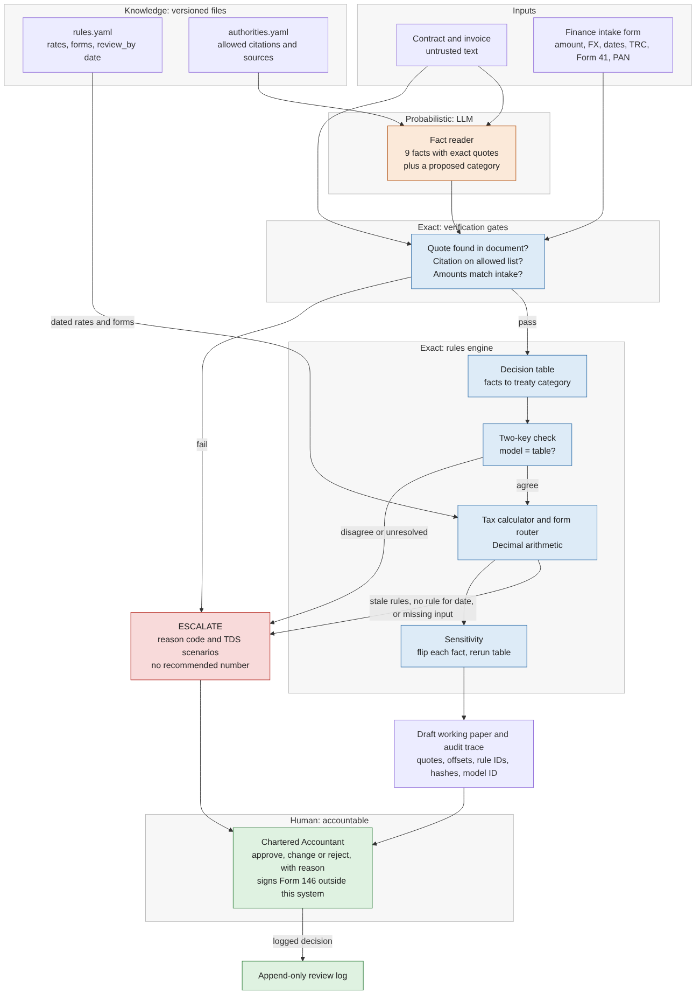

# RemitCheck architecture

RemitCheck prepares a draft working paper for a Chartered Accountant (CA) reviewing an Indian company's payment to a US vendor for software or technical services. It does not give tax advice or issue a certificate.

**Design rule:** the model reads, code decides and calculates, and the CA is accountable.

## What each part does

| Part | Type | Job | Why it sits here |
|---|---|---|---|
| Fact reader | Probabilistic | Answers 9 fixed questions with quotes, and proposes a category | Contract language varies and labels can mislead |
| Verification gates | Exact | Rejects invented quotes, unknown citations and amount conflicts | Model output is not trusted until checked |
| Decision table | Exact | Maps verified facts to a treaty category or an escalation code | The same facts must always give the same result |
| Two-key check | Exact | Compares the model's proposal with the table's result | Disagreement is a useful sign of doubt |
| Tax calculator | Exact | Calculates TDS with `Decimal`, using rates from the rule pack | A model must not do tax arithmetic |
| Sensitivity | Exact | Flips one fact at a time and reruns the table | The CA sees which facts the result depends on |
| CA | Human | Approves, changes or rejects, with a reason | Only a practising CA can issue the certificate |

Amounts, FX rates, dates and document status come from a finance intake form. The model cannot change them. It only reports the amounts it finds, so code can compare them with the intake.

## Where knowledge lives and how it goes out of date

- `knowledge/rules.yaml` holds rates, thresholds and form names, each with a date range, source and status.
- `knowledge/authorities.yaml` is the closed list of authorities the model may cite.
- A rate change is a data edit. A test confirms this.
- After the pack's `review_by` date, every case escalates. A date with no matching rules also escalates.
- Rules based on a secondary or carried-forward source appear as items to confirm on the working paper.

There is no automatic legal update feed. A named person must review the pack. If that review is skipped, the system stops rather than applying old rules silently.

## When it escalates

| Code | Trigger |
|---|---|
| `PE_RISK` | Vendor presence in India; this analysis is out of scope |
| `MIXED_UNALLOCATED` | One price covers items that may be taxed differently |
| `MISSING_MAKE_AVAILABLE_FACT` | Contract does not settle whether know-how passes to the customer |
| `CONTESTED_TRAINING` | Later training, where MoU Example 8 and *Openwave* point different ways |
| `INSUFFICIENT_FACTS` | Facts do not identify what is being paid for |
| `UNVERIFIED_QUOTE`, `UNKNOWN_CITATION` | Quote not in the documents, or citation not on the allowed list |
| `AMOUNT_CONFLICT` | Contract or invoice disagrees with the intake |
| `TWO_KEY_DISAGREEMENT` | Model and decision table differ |
| `READER_FAILED` | Model call failed or returned unusable output |
| `REGIME_TRANSITION` | Credit and remittance fall under different Acts |
| `RULE_PACK_STALE`, `NO_RULE_FOR_DATE` | Rules are past review, or do not cover the date |
| `TREATY_DOCS_MISSING_FOR_NIL_RATE` | A nil treaty result lacks its supporting documents |
| `FX_RATE_MISSING`, `SURCHARGE_BAND_UNKNOWN` | An input needed for calculation is missing |
| `AO_CERTIFICATE`, `OUT_OF_SCOPE_PAYEE` | Case falls outside the prototype's scope |

An escalated paper shows TDS under each possible category, but no single recommended figure.

## How an auditor traces a result

Each `trace.json` records:

- Document hashes and the exact quote behind each fact, with character positions
- Rule pack version and the rule IDs used
- Requested model, served model and prompt hash
- The result of every gate and each calculation step

CA decisions are added to `review_log.jsonl` with a hash of the trace file. The log is append-only by convention in this prototype; it is not tamper-proof.

## Known weak points

1. **The fact definitions and decision table are the biggest risk.** They compress legal judgment into 9 facts, and a CA has not reviewed them. A wrong rule would be applied consistently, and the gates would not catch it.
2. **A real quote can support a wrong answer.** Quote checks prove that the text exists, not that it means what the model says.
3. **The two-key check is not independent.** The same model produces both the facts and the proposal, so it can make the same mistake twice.
4. **"Silent" hides missing rights.** If the model wrongly marks a rights clause as silent, and no other check catches it, the result can be wrong.
5. **External facts stay external.** Side letters, actual conduct and later amendments are invisible unless supplied.
6. **Automation bias.** A tidy draft may make a CA less careful, especially on nil-tax results.

## Legal and accountability limits

- Output is always a draft. The status is `READY_FOR_CA_REVIEW`, never "approved".
- The CA remains responsible for Form 146 and files it outside this system.
- Client contracts would need a data agreement and a model provider with suitable retention terms. The prototype uses synthetic data only.

## Scope

**Jurisdiction:** India, with US company payees under the India-US treaty.

**Out of scope:** Other treaties, permanent establishment analysis, transfer pricing, splitting mixed contracts, Assessing Officer certificates, marginal relief on surcharge, FX rate selection, RBI purpose codes and portal filing.

**Another treaty would need:** New rates and authorities, plus a new decision table. Many treaties have no "make available" test, so the fact questions would change too.
